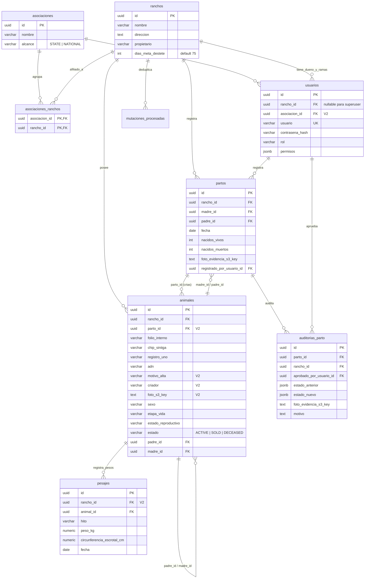
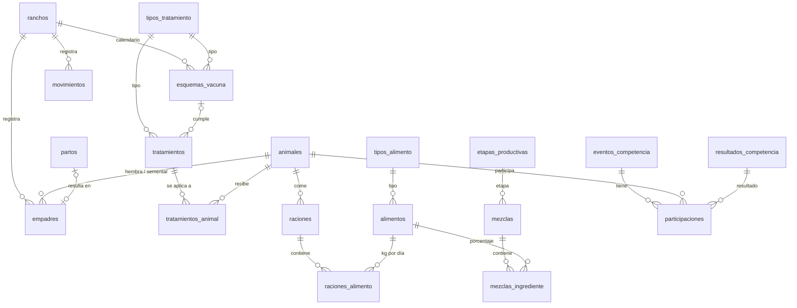

# Diseño y Documentación de Base de Datos — BaaPP / OviApp

> **Motor principal:** PostgreSQL 16.10 (Amazon RDS `db.t4g.micro`, DB `oviapp`, migraciones vía Flyway)  
> **Caché offline móvil:** SQLite vía SQLDelight (`BaaPP-app/shared/src/commonMain/sqldelight/com/agrotech/oviapp/db/OviAppDatabase.sq`)  
> **Principio rector:** Cero borrado físico en animales/auditorías, identificadores de negocio desacoplados de llaves primarias `UUIDv7` y separación estricta entre **Fase 1 (MVP)** y **Fase 2**.

---

## 1. Estado Actual vs. Regla Crítica de Flyway

El archivo `BaaPP-backend/src/main/resources/db/migration/V1__init_schema.sql` **ya se encuentra ejecutado en RDS (`baapp-staging-db`)**.

> **IMPORTANTE — Nunca editar `V1__init_schema.sql`:** Flyway valida el checksum al arrancar Spring Boot; modificar `V1` rompería el arranque en Elastic Beanstalk. Todo ajuste debe crearse como una nueva migración incremental (`V2__*.sql`, `V3__*.sql`, etc.).

### Migraciones (rama `feat/v2-mvp-gaps`)

| Archivo | Contenido | Estado |
| :--- | :--- | :--- |
| `V1__init_schema.sql` | 7 tablas base, en español | Reescrita: requiere reiniciar la base de staging |
| `V2__mvp_gaps_and_indexes.sql` | §4: asociaciones, columnas faltantes de `animales` / `partos` / `pesajes` y 7 índices | Nueva |
| `V3__reproduccion_salud_alimentacion_finanzas.sql` | 4 catálogos + 12 tablas (§8): empadres, salud, alimentación, competencias y movimientos | Nueva |
| `V4__vistas.sql` | 24 vistas de lectura (§9). Para cambiarlas, una migración nueva con `CREATE OR REPLACE VIEW` | Nueva |

> V2 llena `pesajes.rancho_id` desde `animales` antes de ponerle `NOT NULL`, así que funciona aunque staging ya tenga pesajes. Probado en PostgreSQL (Neon) con y sin pesajes previos.
> **Todo el esquema está en español** (tablas y columnas). V1 se reescribió en español de común acuerdo con el equipo: la base de staging en RDS se reinicia para que Flyway la aplique desde cero sin error de checksum. Los **valores** de los `CHECK` siguen en inglés (`FEMALE`, `ACTIVE`, `PREGNANT`, `HERD`, `INCOME`…) porque son los enums de Kotlin.

### Inventario de lo ya construido en `V1` (7 tablas)

| Tabla | Propósito actual | Observación / Estado |
| :--- | :--- | :--- |
| `ranchos` | Catálogo de ranchos (`dias_meta_destete` = 75) | Falta vínculo con Asociación. |
| `usuarios` | Cuentas `OWNER`, `WORKER_BRANCH`, `VET_TECHNICIAN`, `ASSOCIATION_SUPERUSER` + `permisos` (`JSONB`) | Falta relación multi-rancho para Asociación/Técnico. |
| `animales` | Ficha individual con dimensiones ortogonales (`sexo`, `etapa_vida`, `estado_reproductivo`, `estado`), pedigrí (`padre_id`, `madre_id`), mortalidad | Faltan `motivo_alta`, `criador`, `foto_s3_key`, `parto_id`, e índices. |
| `partos` | Eventos de parto con foto obligatoria (`foto_evidencia_s3_key`) y conteo `nacidos_vivos` / `nacidos_muertos` | Falta `tipo_parto`, `metodo_concepcion` y estado de bloqueo/auditoría. |
| `auditorias_parto` | Bitácora inmutable (`estado_anterior`, `estado_nuevo` en `JSONB`, foto y motivo) para correcciones de Asociación/Técnico | Completa para MVP. |
| `pesajes` | Pesajes (`BIRTH`, `WEANING`, `DAY_120`, `DAY_150`, `EVALUATION`) + `circunferencia_escrotal_cm` | Falta `rancho_id` e índice por animal/fecha. |
| `mutaciones_procesadas` | Idempotencia de sincronización offline (`mutacion_id`) | Completa para MVP. |

---

## 2. Arquitectura Entidad-Relación (ERD)

---

## 3. Decisiones de Diseño Clave

1. **UUIDv7 vs. Identificadores de Negocio:** Todas las tablas usan `id UUID PRIMARY KEY` generable offline en el móvil (`BaaPP-app`). El folio de corral (`folio_interno`, ej. `79`), el arete SINIIGA (`chip_siniiga`, prefijo `484...`) y el registro (`registro_uno`, ej. `268309MM-RP`) son columnas de negocio separadas con unicidad compuesta `UNIQUE (rancho_id, folio_interno)`, permitiendo reemplazar aretes perdidos sin romper llaves foráneas.
2. **Dimensiones Ortogonales en `animales`:** Nunca mezclar sexo, etapa y estado fisiológico en un solo campo. Se mantienen separados:
   - `sexo`: `FEMALE`, `MALE`
   - `etapa_vida`: `LAMB_LACTATING`, `LAMB_FATTENING`, `EWE_REPLACEMENT`, `ADULT`
   - `estado_reproductivo`: `EMPTY`, `PREGNANT`, `LACTATING`, `STUD_RAM`
   - `estado`: `ACTIVE`, `SOLD`, `DECEASED`
3. **`VARCHAR + CHECK` en lugar de `CREATE TYPE AS ENUM`:** Consistente con `V1`, evita migraciones complejas en PostgreSQL al agregar valores futuros.
4. **Cero Borrado Físico (`DELETE` prohibido en `animales`):** Un animal fallecido pasa a `estado = 'DECEASED'` con `fecha_muerte`, `causa_muerte` y `etapa_al_morir`. Así se preservan indicadores de mortalidad y la detección de vientres improductivos.
5. **Regla Anti-Fraude de 30 Días e Inmutabilidad:**
   - Todo parto en `partos` exige `foto_evidencia_s3_key` no vacío y valida `0 <= today - fecha_nacimiento <= 30` días.
   - Productores (`OWNER`, `WORKER_BRANCH`) no tienen permiso de `UPDATE/DELETE` sobre `partos`.
   - Correcciones posteriores o altas fuera de plazo las ejecuta exclusivamente `ASSOCIATION_SUPERUSER` o `VET_TECHNICIAN`, dejando registro obligatorio en `auditorias_parto`.
6. **Genealogía Bidireccional (`WITH RECURSIVE`):** `padre_id` y `madre_id` apuntan a `animales(id)` (con respaldo de texto `folio_padre_externo` / `folio_madre_externo` para progenitores externos). Permite navegar Madre ↔ Crías ↔ Semental y resolver árboles de 3–4 generaciones en una sola consulta recursiva.
7. **Campos Derivados NO Almacenados:** Edad en meses/días, ganancia diaria de peso (GDP), tasa de preñez, tasa de partos, prolificidad, intervalo entre ciclos (275 días) y días de engorda se calculan en dominio (`ZootechnicalCalculator`) o en la exportación Excel (`FastExcelSabanaExporter`), nunca como columnas persistidas que puedan desincronizarse.

---

## 4. Diccionario de Datos — Delta Necesario en `V2` (Fase 1 MVP)

`V1` cubre la base, pero presenta **huecos concretos para operar Fase 1** que deben resolverse en `V2__mvp_gaps_and_indexes.sql`:

### A. Multi-tenancy de Asociación (faltante en `V1`, referenciado en `RanchContextInterceptor`)
* **`asociaciones`**: `id UUID PK`, `nombre VARCHAR(150) NOT NULL`, `clave VARCHAR(40) UNIQUE`, `creado_en TIMESTAMPTZ`.
* **`asociaciones_ranchos`**: `asociacion_id UUID FK`, `rancho_id UUID FK`, `afiliado_en TIMESTAMPTZ`, `PRIMARY KEY (asociacion_id, rancho_id)`.
* **`usuarios.asociacion_id`**: `UUID REFERENCES asociaciones(id)` (nullable; usado por `ASSOCIATION_SUPERUSER` y `VET_TECHNICIAN` para autorizar el header `X-Active-Ranch-Id`).

### B. Ficha Individual (`animales`) y Conciliación de Partos (`partos`)
* **`animales.motivo_alta`**: `VARCHAR(20) NOT NULL DEFAULT 'BIRTH' CHECK (motivo_alta IN ('BIRTH', 'PURCHASE', 'REENTRY', 'TRANSFER', 'OTHER'))` — requerido por la Reseña MVP (Sesión 2, p. 14).
* **`animales.criador`**: `VARCHAR(150)` — distingue *Criador* de *Propietario actual* en el certificado rosa/azul (Sesión 2, p. 8 y 17).
* **`animales.foto_s3_key`**: `TEXT` — fotografía del ejemplar en su ficha.
* **`animales.parto_id`**: `UUID REFERENCES partos(id)` — vincula las crías creadas con su evento de parto para conciliar solicitudes de chips SINIIGA a los 5 meses (`nacidos_vivos` menos crías con `estado = 'DECEASED'`).
* **`animales.actualizado_en`** y **`partos.actualizado_en`**: `TIMESTAMPTZ NOT NULL DEFAULT NOW()` — necesario para sincronización incremental (pull) en móvil.
* **`pesajes.rancho_id`**: `UUID NOT NULL REFERENCES ranchos(id)` — evita joins innecesarios al validar aislamiento por rancho y al sincronizar.

### C. Índices de Rendimiento (ausentes en `V1`)
* `CREATE INDEX idx_animales_rancho_estado ON animales (rancho_id, estado);`
* `CREATE INDEX idx_animales_padre ON animales (padre_id) WHERE padre_id IS NOT NULL;`
* `CREATE INDEX idx_animales_madre ON animales (madre_id) WHERE madre_id IS NOT NULL;`
* `CREATE INDEX idx_animales_destete_pendiente ON animales (fecha_nacimiento) WHERE estado = 'ACTIVE' AND fecha_destete IS NULL;` (para `WeaningAlertScheduler` a los 75 días).
* `CREATE UNIQUE INDEX uq_animales_rancho_chip ON animales (rancho_id, chip_siniiga) WHERE chip_siniiga IS NOT NULL;`
* `CREATE INDEX idx_pesajes_animal_fecha ON pesajes (animal_id, fecha DESC);`
* `CREATE INDEX idx_partos_rancho_fecha ON partos (rancho_id, fecha_nacimiento DESC);`

---

## 5. Mapeo Exacto de las 24 Columnas de la Sábana (`A`–`X`)

Basado en `SABANA OCT 2026 DORPER.xlsx` (Sesión 2, pp. 12–13):

| Col | Encabezado Sábana | Origen en Base de Datos / Cálculo |
| :---: | :--- | :--- |
| **A** | `folio` | `animales.folio_interno` |
| **B** | `adn` | `animales.adn` |
| **C** | `CHIP` (SINIIGA) | `animales.chip_siniiga` |
| **D** | `FECHA NACIMIENTO` | `animales.fecha_nacimiento` |
| **E** | `FECHA DESTETE` | `animales.fecha_destete` |
| **F** | `EDAD MESES` | **Derivado:** `(fecha_corte - fecha_nacimiento) / 30.0` |
| **G** | `EDAD DIAS` | **Derivado:** `fecha_corte - fecha_nacimiento` |
| **H** | `PESO NACIMIENTO` | `pesajes.peso_kg` (`hito = 'BIRTH'`) |
| **I** | `PESO 120 DIAS` | `pesajes.peso_kg` (`hito = 'DAY_120'`) |
| **J** | `PESO 150 DIAS` | `pesajes.peso_kg` (`hito = 'DAY_150'`) |
| **K** | `PESO A LA EVALUACION` | `pesajes.peso_kg` (`hito = 'EVALUATION'`) |
| **L** | `CIRCUNFERENCIA` | `pesajes.circunferencia_escrotal_cm` (machos) |
| **M** | `PESO DESTETE` | `pesajes.peso_kg` (`hito = 'WEANING'`) |
| **N** | `TIPO DESTETE` | `animales.tipo_parto` *(o campo separado si difiere por mortalidad previa al destete)* |
| **O** | `PADRE` | `sire.folio_interno` o `animales.folio_padre_externo` |
| **P** | `FOLIO PADRE` (UNO) | `sire.registro_uno` *(pendiente validar si padre externo requiere `external_sire_registro_uno`)* |
| **Q** | `MADRE` | `dam.folio_interno` o `animales.folio_madre_externo` |
| **R** | `FOLIO MADRE` (UNO) | `dam.registro_uno` |
| **S** | `RAZA` | `animales.raza` |
| **T** | `TIPO DE PARTO` | `animales.tipo_parto` (`SIMPLE`, `TWIN`, `TRIPLET`, `QUADRUPLET`, `QUINTUPLET`) |
| **U** | `CONCEPCION` | `animales.metodo_concepcion` (`MN`, `IA`, `TE`) |
| **V** | `COLOR` | `animales.color` |
| **W** | `SEXO` | `animales.sexo` (`FEMALE` → HEMBRA, `MALE` → MACHO) |
| **X** | `(=AHORA())` | **Derivado:** fecha de corte de generación del `.xlsx` |

---

## 6. Paridad Offline en SQLite (`BaaPP-app` / SQLDelight)

El archivo `BaaPP-app/shared/src/commonMain/sqldelight/com/agrotech/oviapp/db/OviAppDatabase.sq` actualmente solo tiene `local_animals` (incompleta) y `pending_sync_events`. Para soportar captura y lectura offline en Fase 1 debe ampliarse con:
1. Completar `local_animals` con `adn`, `tipo_parto`, `metodo_concepcion`, `folio_padre_externo`, `folio_madre_externo`, `motivo_alta`, `criador`, `foto_s3_key`, `parto_id`, `fecha_muerte`, `causa_muerte`, `actualizado_en`.
2. Agregar **`local_birth_events`** y **`local_weight_measurements`** (espejo mínimo de PostgreSQL) para consultar historial y ejecutar validaciones locales antes de que `WorkManager` vacíe `pending_sync_events` hacia `POST /api/v1/sync/batch`.

---

## 7. Alcance Diferido a Fase 2 (`V3+` — NO construir en MVP)

> **Actualización:** parte de este alcance se adelantó en `V3` (ver §8): sanidad (calendario y tratamientos), nutrición (catálogo con marcas, dietas por animal y mezclas), competencias y movimientos de dinero. Siguen pendientes: corrales y cuarentena, precios regionales por rancho, parámetros del ciclo de 275 días.

Siguiendo la hoja de ruta de los documentos de arquitectura y requerimientos, estas tablas quedan **documentadas como evolución futura** pero excluidas del MVP para evitar sobreingeniería:
1. **Corrales y Sanidad (`corrals`, `sanitary_events`):** Asignación de corral físico (incluyendo área de Cuarentena / Enfermería con estado en tratamiento y diagnóstico) y cartilla sanitaria en 4 rubros: Vacunación, Vitaminación, Selenio y Desparasitación.
2. **Nutrición y Costos por Etapa (`nutritional_stage_requirements`, `feed_ingredients`, `ranch_ingredient_prices`, `diet_formulas`, `diet_formula_items`):** Requerimientos fijos por las 5 etapas (*Lactancia, Crecimiento, Desarrollo, Engorda, Mantenimiento*), catálogo de granos con `% proteína` fijo y precio regional editable por rancho para simular sustituciones (`$/kg TCO`).
3. **Parámetros Productivos y Financieros (Ciclo 275 días):** `ranch_production_parameters` (sobrescribiendo valores base del Excel del Mtro. Meléndez) y `financial_transactions` (costos no alimenticios: medicamentos, mano de obra, transporte, infraestructura y ventas).
4. **Exposiciones / Campeonatos (`animal_championships`):** Premios en ferias ganaderas (Cordera, Joven, Raza, Suprema, fecha y foto S3).

---

## 8. Tablas de `V3` (nombres en español)

| Tabla | Tipo | Qué guarda | Reglas (`CHECK` / `UNIQUE`) |
| :--- | :--- | :--- | :--- |
| `tipos_tratamiento` | Catálogo | Vacuna, Desparasitación, Vitaminas, Selenio, Curación, Enfermedad, Revisión | `nombre` único |
| `tipos_alimento` | Catálogo | Preiniciador … Subproducto | `nombre` único |
| `etapas_productivas` | Catálogo | Las 5 etapas con rango de proteína | `min <= max <= 40` |
| `resultados_competencia` | Catálogo | Gran campeón … Participó, con puntos | `puntos 0..100` |
| `empadres` | Entidad | Monta / IA / TE, diagnóstico de gestación y parto resultante | hembra ≠ semental; diagnóstico ≥ 30 días después; `PREGNANT`/`EMPTY` |
| `esquemas_vacuna` | Entidad | Calendario sanitario por rancho | edad inicio 0..730; frecuencia 15..730 días |
| `tratamientos` | Entidad | Aplicación al rebaño, a corderos o individual | próxima fecha > fecha |
| `tratamientos_animal` | M:N | A qué animales se aplicó y con qué dosis | dosis 0..50 ml; un renglón por animal |
| `alimentos` | Entidad | Catálogo con marca, proteína, energía y precio | `rancho_id` NULL = catálogo general |
| `raciones` | Entidad | Dieta de un animal desde una fecha (historial) | una por animal y fecha |
| `raciones_alimento` | M:N | Kilos por día de cada alimento | 0..6 kg/día |
| `mezclas` | Entidad | Fórmula del rancho para una etapa | nombre único por rancho |
| `mezclas_ingrediente` | M:N | Porcentaje de cada ingrediente | 0..100; la suma de 100 % la valida `v_mezcla_nutricion` |
| `eventos_competencia` | Entidad | Ferias y exposiciones | nombre + fecha únicos |
| `participaciones` | M:N | Animal × evento: categoría, resultado y foto | una por animal, evento y categoría |
| `movimientos` | Entidad | Ventas (`INCOME`) y gastos (`EXPENSE`) | monto > 0 |

Las FK hacia `animales` no tienen `ON DELETE` (RESTRICT): un animal nunca se borra físicamente (§3.4). Los renglones hijos de `tratamientos`, `raciones` y `mezclas` sí se borran en cascada con su padre.

---

## 9. Vistas de lectura (`V4__vistas.sql`)

Cada pantalla pide su vista con un filtro sencillo (`WHERE rancho_id = :rancho`, `animal_id = :animal`). Los indicadores se calculan al consultar; no se guardan (§3.7).

| Vista | Pantalla | Técnica |
| :--- | :--- | :--- |
| `v_animal_resumen` | Lista del rebaño y ficha | LATERAL (último peso) |
| `v_resumen_rancho` | Inicio / selector multi-rancho | GROUP BY, vista sobre vista |
| `v_pesaje_ganancia` | Pesaje e historial de peso | `LAG` |
| `v_genealogia` | Certificado rosa/azul (3 generaciones) | `WITH RECURSIVE` |
| `v_cargadas` | Borregas gestantes y fecha probable (150 d) | — |
| `v_partos` | Partos, crías y bloqueo de 30 días | LATERAL, `STRING_AGG` |
| `v_reproduccion_temporada` | % preñez, % parto, prolificidad y mortalidad por trimestre | GROUP BY |
| `v_historial_reproductivo_hembra` | Selección de hembras y vientres improductivos | LATERAL |
| `v_ranking_crecimiento` | GDP de corderos, fecha de venta (35 kg) y destino | `REGR_SLOPE`, `PERCENT_RANK` |
| `v_peso_etapa` | Peso por hito contra el promedio del rancho | `DISTINCT ON`, `AVG OVER` |
| `v_estado_vacunas` | Vacunas faltantes por animal | subconsulta |
| `v_cobertura_vacunas` | Cobertura del calendario por rancho | GROUP BY, vista sobre vista |
| `v_historial_salud` | Historial sanitario (ficha: `:animal = ANY(animal_ids)`) | GROUP BY, `ARRAY_AGG` |
| `v_racion_periodo` | Dieta actual e historial por animal | `LEAD` |
| `v_consumo_marca_rancho` | Consumo y costo por marca | GROUP BY, `SUM OVER` |
| `v_alimentacion_hoy` | Kilos y costo de hoy / al mes | GROUP BY |
| `v_catalogo_alimento` | Recomendar y comparar alimentos | `RANK` |
| `v_mezcla_nutricion` | Simulador de dietas (proteína, energía, $/kg, suma 100 %) | GROUP BY |
| `v_finanzas_mensual` | Ventas, gastos y utilidad acumulada | GROUP BY, `SUM OVER` |
| `v_competencias_animal` | Premios del animal | `RANK` |
| `v_tamano_rebano_mensual` | Tamaño del rebaño en 12 meses | `GENERATE_SERIES` |
| `v_composicion_rebano` | Composición por sexo, etapa y raza | GROUP BY, vista sobre vista |
| `v_desempeno_semental` | Selección de sementales | LATERAL |
| `v_sabana` | Sábana oficial de 24 columnas (§5) | LATERAL, `ARRAY_AGG FILTER` |

> **Limitación conocida:** V1 no guarda la fecha de venta, así que `v_tamano_rebano_mensual` solo cuenta a los vendidos mientras siguen activos. Si se necesita, agregar `animales.sale_date` en una migración futura.
